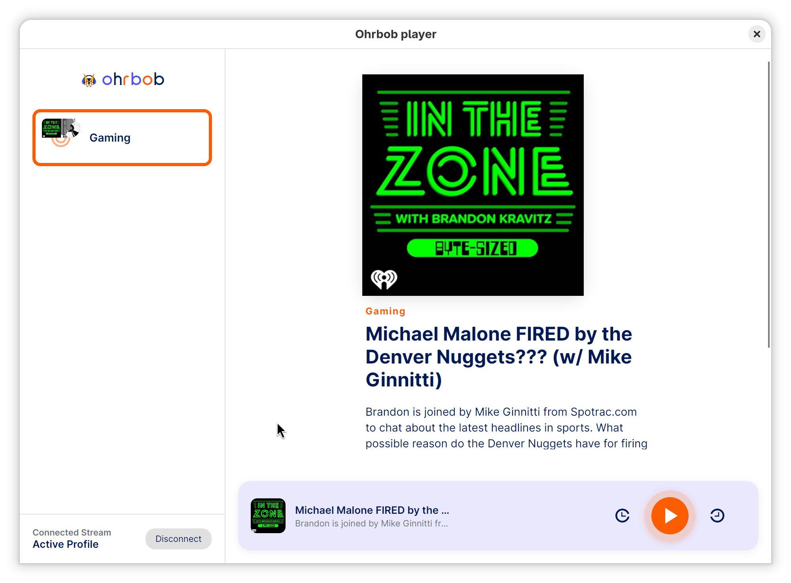

# Ohrbob App

The cross-platform desktop (Linux, Windows, Mac) & mobile (iOS, Android) player client for **[Ohrbob](https://ohrbob.org)**, built with **Avalonia UI** and **CommunityToolkit.Mvvm**.

Ohrbob is your free and open-source radio station manager. With ohrbob you build your own radio stations and listen to them anywhere. 



## Features
- **Easy Setup**: You setup the Player with your ohrbob.org with a single click
- **Theme**: The player automatically adjust according to your system theme (dark and light mode are available)
- **Responsive**: The player window can work in tiny window in portrait mode or take full landscape mode size on your desktop
- **Persistent Sync**: The player is syncing your playback state so you can continue to listen anywhere exactly where you were
- **Media API**: On mobile and desktop the player registers correctly as a media player so you see and can control it via lock screens (eg. android) and notifications (eg. gnome)
---

This is still really early and a lot of features are missing - but the basic functionality is there and I want to test how to deploy this to flatpak. 

## Disclosure Note on Generative AI

The boilerplate code for this setup and some of its features have been written by generative AI. 

Models used: DeepSeek v4.1 Flash via OpenCode CLI

## Install

Grab the latest build from the [releases page](https://github.com/ohrbob-org/ohrbob.app/releases/latest).

### Linux

Download `Ohrbob-<version>-x86_64.AppImage`, make it executable and run it:

```bash
chmod +x Ohrbob-*-x86_64.AppImage
./Ohrbob-*-x86_64.AppImage
```

The AppImage needs FUSE 2. On distributions without `libfuse2`, run it with `--appimage-extract-and-run` instead.

### Windows

Download `OhrbobSetup-<version>.exe` and run it. Windows SmartScreen may warn about an unknown publisher — choose **More info** → **Run anyway**.

### Android

Download `Ohrbob-<version>.apk` on your device and open it. Android will ask you to allow installs from this source; allow it and continue.

The APK is signed with the Android debug key, so it is meant for sideloading rather than the Play Store, and Android may warn about the developer.

## Self-Hosting

The player can easily connect to your self-hosted ohrbob instance. You want to self-host ohrbob.server? You need to go here: https://github.com/ohrbob-org/ohrbob.server

## Building it yourself

### Prerequisites
- .NET 10.0 SDK

### Launch the Application
To launch the app directly from your terminal, run:

```bash
dotnet run --project Ohrbob.App/Ohrbob.App.csproj
```

### Run Tests
To run the full test suite (including unit tests and headless UI E2E tests):

```bash
dotnet test Ohrbob.App.Tests/Ohrbob.App.Tests.csproj
```


### Launch the Android App

```bash
dotnet run --project Ohrbob.App.Android -p:AndroidSdkDirectory=/home/kaiwegner/Projects/android-emu/android-sdk -- --adb /home/kaiwegner/Projects/android-emu/android-sdk/platform-tools/adb
```

---
